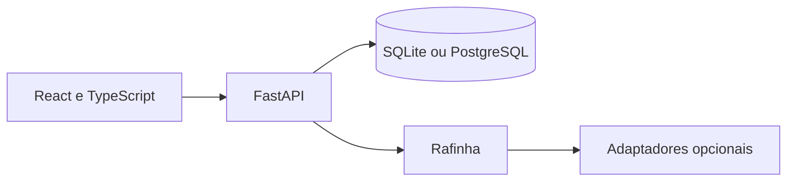

# Ateliê Verde

## 1. Apresentação

Aplicação de jardinagem e paisagismo com portal do cliente e gestão administrativa.

## 2. Problema empresarial

Conectar catálogo, compras, serviços, projetos e rotina financeira em um mesmo fluxo.

## 3. Objetivo

Compartilhar regras entre o portal e a gestão, preservando escopo e privacidade por usuário.

## 4. Funcionalidades implementadas

- Catálogo, carrinho, pedidos e estoque.
- Clientes, fornecedores, agenda, serviços e orçamentos.
- Projetos e acompanhamento de execução, consumo e financeiro.
- Assistente Rafinha e adaptadores opcionais configuráveis.

As funcionalidades foram identificadas nos módulos e na documentação originais. Os resultados de verificação desta cópia estão em [Validação](docs/github/VALIDACAO.md); não se alegam ganhos de negócio ou métricas de produção.

## 5. Tecnologias

Python 3.12+, FastAPI, SQLAlchemy, Alembic, React, TypeScript e Vite. SQLite atende à demonstração local; PostgreSQL possui configuração e migrations. Testes com pytest e Playwright.

Os manifests originais foram preservados. Nenhuma dependência nova foi adicionada à aplicação para esta apresentação.

## 6. Arquitetura



[Arquitetura e limites da cópia](docs/github/ARQUITETURA.md).

## 7. Estrutura de pastas

```text
backend/app/         API, regras, modelos e demonstração
backend/migrations/  migrations Alembic
backend/tests/       testes backend
frontend/            portal e administração
packaging/           iniciador, allowlist e testes de distribuição
scripts/             execução e ferramentas
docs/                documentação e fontes de mídias
```

Ambientes instalados, caches, bancos operacionais, configurações privadas e compilados ficam fora do pacote fonte. [Critérios de seleção](docs/github/SEGURANCA.md).

## 8. Instalação

Na raiz, com Python 3.12+ e Node.js 22:

```powershell
py -3.12 -m venv .venv
Copy-Item .env.example .env
```

Preencha JWT_SECRET no .env local com um segredo aleatório próprio de pelo menos 32 caracteres antes da execução; preserve o .env.example com o campo vazio. Para conhecer a demonstração sem autorizar contas externas, mantenha Rafinha no provedor catalog:

```powershell
$env:RAFINHA_PROVIDER = 'catalog'
powershell -ExecutionPolicy Bypass -File scripts\iniciar.ps1 -Install -NoBrowser
```

## 9. Configuração do ambiente

A cópia não transporta backend/data, .local, conversas, cofres DPAPI, tokens de contas nem gravações pessoais. Campos de credencial do exemplo estão vazios. Uma eventual conexão pessoal deve ser configurada pelo dono da nova instalação; não é necessária para avaliar catálogo e gestão. Não foram acionados provedores nesta preparação.

## 10. Como executar

Após a instalação, com o ambiente local configurado:

```powershell
powershell -ExecutionPolicy Bypass -File scripts\iniciar.ps1 -NoBrowser
```

Interface: http://127.0.0.1:5173. API: http://127.0.0.1:8015/docs. O script prepara a demonstração local; use os acessos demonstrativos apresentados pela aplicação. Para encerrar, use scripts/parar.ps1 apenas na cópia que iniciou os processos.

Os comandos desta documentação se destinam a uma cópia preparada pelo leitor; não foram usados para iniciar a operação do autor nesta etapa.

## 11. Como testar

```powershell
.\.venv\Scripts\python.exe -m pytest backend/tests packaging/tests -q
npm.cmd --prefix frontend run build
```

Há também testes Playwright em frontend/tests. Eles exigem preparação específica de navegador e serviços; a validação desta etapa está discriminada no documento de resultados.

[Resultados e limitações da verificação desta preparação](docs/github/VALIDACAO.md).

## 12. Capturas e demonstrações reais

[Veja as telas e demonstrações já existentes no portfólio](https://leandroaugferreira.github.io/atelie-verde.html). Não foram criadas imagens fictícias nem alteradas as mídias do projeto.

## 13. Limitações conhecidas

Integrações do assistente exigem configuração/autorizações próprias e não estão certificadas por esta revisão. As mídias mantêm suas atribuições e termos próprios; esta publicação não transfere direitos de terceiros. Documentação histórica pode mencionar configurações anteriores. Não há cofre pessoal ou banco operacional nesta cópia.

## 14. Estado atual

Código-fonte disponibilizado pelo autor para demonstração e avaliação técnica. A validação completa de 03/11/2026 e os resultados do GitHub Actions estão em [docs/github/VALIDACAO.md](docs/github/VALIDACAO.md).

A escolha de licença depende da aprovação do autor; nenhuma licença nova foi atribuída.

[Fontes de plantas](docs/FONTES_PLANTAS.md) · [Paisagismo](docs/PAISAGISMO-VIRTUAL.md)

## 15. Portfólio

[Ateliê Verde no portfólio](https://leandroaugferreira.github.io/atelie-verde.html) · [Portfólio completo](https://leandroaugferreira.github.io/).

## 16. Estudo técnico para recrutamento — API, transações e demonstração

- [Auditoria, arquitetura, estudo de caso e perguntas para entrevistas](docs/recrutamento/AUDITORIA.md).
- [Demo interativa no navegador](https://leandroaugferreira.github.io/atelie-verde-demo.html): **simulação estática**, sem API, banco, login ou pagamentos reais. O visitante pode explorar compra/cancelamento e orçamento/projeto usando dados fictícios.
- [Três testes de integração novos](backend/tests/test_recruiting_case.py): pedido idempotente, estoque/financeiro, cancelamento de pedido pago e conversão autorizada de orçamento em projeto.
- [Evidências verificáveis](https://github.com/LeandroAugFerreira/atelie-verde/actions/runs/42531033867): **538 testes API aprovados em SQLite e 538 em PostgreSQL**, **60 Playwright Chromium aprovados**, Ruff, migrações SQLite/PostgreSQL e build React aprovados. Esses resultados são do CI de 08/11/2026, antes da integração dos documentos à main.
- [Roteiro de 3 minutos](docs/recrutamento/ROTEIRO_DEMO.md), [15 perguntas técnicas](docs/recrutamento/ENTREVISTA_TECNICA.md) e [plano de melhorias](docs/recrutamento/PLANO_DE_MELHORIAS.md).

Os números de preço e estoque são **fixtures de teste**, não vendas/receita/compras de clientes reais. A conta financeira é registro interno, não um gateway de pagamento. O assistente Rafinha possui integrações pessoais opcionais e esta demonstração não as executa. O backend completo não foi hospedado publicamente.
