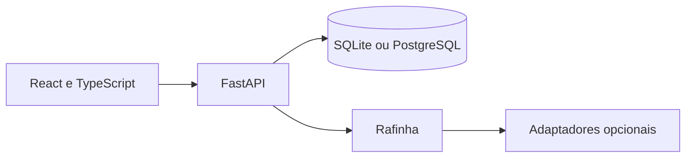

# Arquitetura observada

Python 3.12+, FastAPI, SQLAlchemy, Alembic, React, TypeScript e Vite. SQLite atende à demonstração local; PostgreSQL possui configuração e migrations. Testes com pytest e Playwright.

Integrações do assistente exigem configuração/autorizações próprias e não estão certificadas por esta revisão. As mídias e suas fontes precisam de aceite de direitos antes de publicação pública. Documentação histórica pode mencionar configurações anteriores. Não há cofre pessoal ou banco operacional nesta cópia.

O diagrama resume relações encontradas no código; não representa uma implantação em produção. Serviços externos opcionais não foram ativados nesta preparação.
